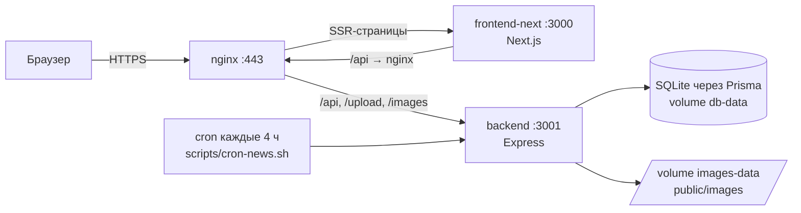

# Padel Russia 🏓

Каталог падел-клубов и кортов России с новостным порталом: **234 клуба** из безключевых источников, карты, отзывы, автоматический перевод новостей и админ-панель.

🌐 **Сайт:** [https://padel-russia.online](https://padel-russia.online)

## Возможности

- **Каталог кортов** — список клубов с фильтрами по городу/типу кортов, карточка клуба с картой, часами работы, удобствами, ценами (или «Цена по запросу»), фото и отзывами.
- **Поиск новых клубов** — CLI-скрипт обходит три безключевых источника (PadelMesh, МячМяч, Федерация падела), дедуплицирует против каталога, геокодирует через Nominatim и добавляет клубы в БД — без единого платного API-ключа.
- **Новости** — парсинг RSS-лент каждые 4 часа по cron, автоматический перевод статей через DeepSeek (с идемпотентным дозаполнением), дедуп по `sourceUrl`, ручное управление публикацией в админке.
- **Отзывы и лайки** — оценка клубов, лайки отзывов, JWT-аутентификация.
- **Админ-панель** — CRUD для кортов и статей, загрузка изображений, управление публикациями.
- **SEO** — SSR на Next.js App Router, мета-теги, JSON-LD (SportsClub), sitemap (288 URL), robots.txt.
- **Аналитика** — Яндекс.Метрика (включая вебвизор).

## Стек

| Слой | Технологии |
|---|---|
| Frontend | Next.js 14 (App Router, SSR), React 18, TypeScript, Tailwind CSS, shadcn/ui, TanStack Query, vitest |
| Backend | Express 5, TypeScript, Prisma + SQLite, JWT, Joi, Cheerio, node-cron, Jest |
| Инфраструктура | Docker Compose, nginx (TLS, прокси `/api` → backend, статика → frontend), Let's Encrypt |
| Внешние сервисы | Nominatim/OpenStreetMap (геокодинг), DeepSeek (перевод новостей), Яндекс.Карты, RSS-ленты |

## Архитектура



- `frontend-next/` — публичный сайт (SSR) и страница админки (`/admin`, клиентский React).
- `backend/` — REST API (`/api/*`), модули: `courts`, `articles`, `auth`, `reviews`, `maps`, `scraper` (RSS + перевод), `data-collector`.
- `nginx/prod.conf` — единая точка входа: `/api`, `/upload`, `/images`, `/health` → backend; остальное → frontend.

## Структура репозитория

```
padel-russia/
├── backend/                 # Express API + Prisma + Jest
│   ├── src/modules/         # бизнес-модули (courts, scraper, auth, …)
│   │   └── courts/discovery/# парсеры 3 источников, нормализация, дедуп (с юнит-тестами)
│   └── scripts/             # CLI: discover-courts, geocode-courts, scrape-news, translate-articles
│       └── lib/             # HTTP, статистика, отчёт, --fill-images для discovery
├── frontend-next/           # Next.js 14 (публичный сайт + админка)
├── nginx/                   # конфиг nginx
├── scripts/                 # cron-news.sh и служебные скрипты
├── docker-compose.yml       # dev-окружение
└── docker-compose.prod.yml  # продакшен (backend + frontend + nginx)
```

## Быстрый старт

### Локальная разработка

```bash
# Backend (http://localhost:3001)
cd backend
npm install
npx prisma db push          # создать SQLite-БД
npm run seed                # демо-данные (опционально)
npm run dev

# Frontend (http://localhost:3000)
cd frontend-next
npm install --legacy-peer-deps
NEXT_PUBLIC_API_URL=http://localhost:3001 npm run dev
```

### Docker (продакшен-окружение)

```bash
# секреты — в корневом .env (см. .env.example): JWT_SECRET, DEEPSEEK_API_KEY и т.д.
docker compose -f docker-compose.prod.yml up -d --build
```

nginx слушает 80/443, TLS — Let's Encrypt (`/etc/letsencrypt`). Детали деплоя — в [backend/README.md](backend/README.md) и [frontend-next/README.md](frontend-next/README.md).

## Тесты

```bash
# Backend — Jest (бизнес-логика: discovery, геокодинг, парсеры, перевод, auth)
cd backend && npm test

# Frontend — Vitest (формы админки, sitemap)
cd frontend-next && npx vitest run
```

## Данные и ручные задачи

```bash
cd backend
npm run discover:courts              # dry-run: поиск новых клубов (отчёт в консоль)
npm run discover:courts -- --apply   # записать найденное в каталог
npm run geocode:courts -- --apply    # догеокодить корты без координат
npm run scrape:news                  # вручную запарсить новости
npm run translate:news               # вручную перевести не переведённые статьи
```

Новости по расписанию: cron на сервере (`0 */4 * * *`) вызывает `scripts/cron-news.sh` → парсинг RSS → перевод через DeepSeek → публикация.

## Известные ограничения

- Для перевода новостей нужен пополненный баланс `DEEPSEEK_API_KEY`: при HTTP 402 статьи остаются скрытыми (`published=false`) до успешного перевода — это сделано намеренно, чтобы не публиковать оригиналы на иностранном языке на русскоязычном сайте.
- Два jest-сьюта (`courts`, `reviews`) падают без живой БД/окружения — известная проблема окружения, не регрессия.
- SQLite выбран осознанно: проект однопользовательский по записи (админка), нагрузка — чтение.
